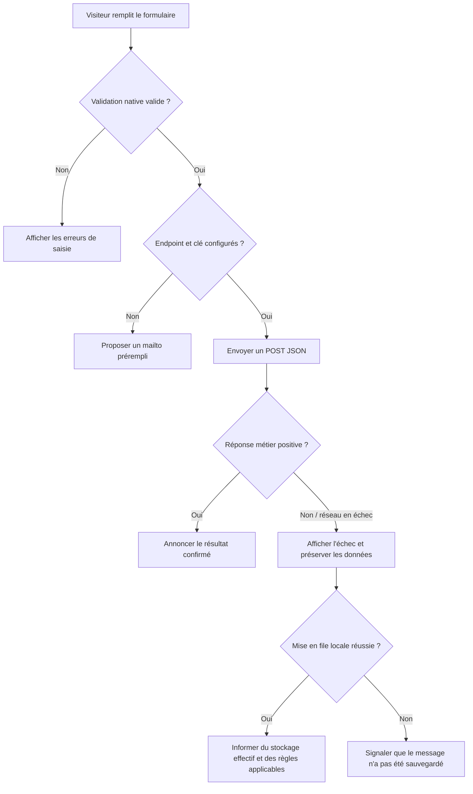

# Modélisation — PGDigital

## 1. Identification

| Information | Valeur |
| --- | --- |
| Produit | PGDigital — portfolio personnel DevOps |
| Propriétaire / commanditaire | Patrick G. |
| Date de mise à jour | 2026-11-10 |
| Version | 1.0 |
| Document de référence | [Analyse des besoins](Analyse%20des%20besoins.md), [PRD](PRD.md) |
| Statut | Modèle conceptuel fondé sur le produit actuel et sa cible éditoriale |

## 2. Objectif et périmètre

PGDigital est un site statique, sans base de données serveur ni classes métier applicatives. Les modèles ci-dessous décrivent les données éditoriales et les parcours utiles pour maintenir le produit; ils ne constituent pas un schéma de base de données déjà implémenté.

L’état courant comporte des faits, services, compétences, outils, coordonnées et liens sociaux dans `json/site-data.json`, ainsi qu’une représentation HTML de repli dans `index.html`. Les études de cas DevOps et la qualification explicite des compétences sont des besoins du PRD, mais ne figurent pas encore dans la structure JSON observée. Leur schéma proposé est donc une cible à valider avant implémentation.

## 3. Modélisation des données

### 3.1 Entités éditoriales observées

| Entité logique | Description | Collection / source actuelle |
| --- | --- | --- |
| Portfolio | Page publique contenant les sections et les groupes de contenu. | `index.html` |
| Fait | Statistique courte avec icône, valeur et libellé. | `facts[]` dans `json/site-data.json` |
| Service | Offre éditoriale avec icône, titre et description. | `services[]` |
| Compétence | Langage ou compétence présentée avec image, nom et description. | `skills[]` |
| Outil | Outil présenté avec image, nom et description. | `tools[]` |
| Contact public | Nom et adresse affichés dans la section Contact. | `contact` |
| Profil social | Lien social fourni avec libellé, icône et URL. | `social[]`; la liste JSON observée est vide |

Les éléments présentés comme compétences ou services doivent être validés par le propriétaire. Leur présence dans le JSON n’est pas à elle seule une preuve de niveau de maîtrise ou d’offre commerciale.

### 3.2 Modèle cible des contenus de compétence et de projet

La structure suivante est une proposition éditoriale issue du PRD et n’existe pas encore dans `site-data.json`.

| Entité cible | Attributs proposés | Règles |
| --- | --- | --- |
| Compétence qualifiée | `name`, `category`, `experienceType`, `level` (facultatif), `summary`, `evidenceIds[]` | `experienceType` distingue expérience professionnelle, projet personnel/formation ou apprentissage; les niveaux doivent être validés et ne pas suggérer une certification non acquise. |
| Étude de cas | `id`, `title`, `context`, `problem`, `personalContribution`, `approach`, `tools[]`, `results[]`, `limitations[]`, `learnings[]`, `authorizationStatus` | Publier uniquement après validation factuelle et autorisation; résultats vérifiables; aucun secret, identifiant, donnée client ou détail opérationnel non autorisé. |
| Résultat vérifiable | `description`, `evidenceReference` (facultatif), `publicationAllowed` | Ne publier que les mesures ou résultats confirmés et autorisés. |

Les champs finaux, les niveaux et la présentation des preuves restent à définir avec le propriétaire. Les références à des outils ne doivent pas être interprétées automatiquement comme des compétences acquises.

### 3.3 Relations conceptuelles et cardinalités

| Entité A | Relation | Entité B | Cardinalité |
| --- | --- | --- | --- |
| Portfolio | contient | Section | 1 à 6 dans la structure actuelle |
| Section Services | présente | Service | 1 à 0..* |
| Section Compétences | présente | Compétence | 1 à 0..* |
| Section Outils | présente | Outil | 1 à 0..* |
| Section À propos | présente | Fait | 1 à 0..* |
| Portfolio | affiche | Contact public | 1 à 1 |
| Portfolio | peut afficher | Profil social | 1 à 0..* |
| Compétence qualifiée (cible) | est étayée par | Étude de cas (cible) | 0..* à 0..* |
| Étude de cas (cible) | présente | Résultat vérifiable (cible) | 1 à 0..* |

Les relations « Compétence — Étude de cas » et « Étude de cas — Résultat » décrivent le modèle cible; elles ne correspondent pas à des liens présents dans les données actuelles.

### 3.4 Modèle logique JSON observé

| Objet / tableau | Champs actuellement observés | Contraintes observées |
| --- | --- | --- |
| `facts[]` | `icon`, `value`, `label` | Liste d’objets; affichée dans le carrousel des faits. |
| `services[]` | `icon`, `title`, `description` | Liste d’objets; affichée dans le carrousel de services. |
| `skills[]` | `name`, `image`, `description` | Liste d’objets; image locale référencée par chemin. |
| `tools[]` | `name`, `image`, `description` | Liste d’objets; image locale référencée par chemin. |
| `contact` | `name`, `address`; `email` facultatif selon le rendu | Un objet de contact public. Ne pas ajouter de donnée personnelle non nécessaire. |
| `social[]` | `label`, `icon`, `url` | Les liens ne sont rendus que si leur URL passe le filtre de schéma; les profils doivent être réels et approuvés. |

Les textes JSON sont rendus avec `textContent` et les URL acceptées sont limitées dans le code aux schémas HTTP(S) et `mailto:`. Toute extension du modèle doit préserver ces règles. Le contenu statique de `index.html` est une source de repli distincte, à maintenir cohérente.

### 3.5 Données de contact et stockage

| Donnée | Emplacement / durée observés | Point à décider |
| --- | --- | --- |
| Nom, prénom, email, message | Formulaire du navigateur; configuration distante dans `json/contact-form.json`. | Confirmer le fournisseur, le destinataire, les conditions, l’information fournie et les règles de rétention. |
| Brouillon | `localStorage`, clé `pgdigital:contact:draft`. | Définir durée, effacement et information du visiteur. |
| File d’envoi | `localStorage`, clé `pgdigital:contact:outbox`, limite configurée par `maxQueued`. | Définir expiration, annulation et comportement sûr en cas d’erreur/quota. |
| Préférence de thème | `localStorage`, clé `dark-mode`. | Préférence locale; suppression gérée par le navigateur ou l’utilisateur. |

Le produit ne possède pas de modèle de persistance serveur propre. Le schéma de stockage local et les comportements d’échec doivent être validés; l’audit a relevé des risques de succès trompeur, perte ou conservation indéfinie à revalider.

## 4. Modélisation des processus

### 4.1 Charger et présenter les contenus

| Étape | Acteur | Action | Résultat |
| --- | --- | --- | --- |
| 1 | Navigateur | Affiche `index.html` et le contenu statique initial. | Page de repli disponible. |
| 2 | `js/data.js` | Demande `json/site-data.json` et `json/contact-form.json` via `fetch`. | Données reçues ou erreur de chargement consignée. |
| 3 | `js/data.js` | Rend le contenu JSON lorsque celui-ci est chargé. | Conteneurs actualisés; textes insérés comme texte, non comme HTML. |
| 4 | `js/custom.js` | Attend l’état partagé des données avant initialisation des composants. | Carrousels et navigation initialisés selon les données disponibles. |
| Alternative | Navigateur | Si `fetch` échoue, notamment en `file://`, garde le contenu HTML statique. | Rendu de repli; cohérence à vérifier lors des changements éditoriaux. |

### 4.2 Parcours de contact

Le flux ci-dessous résume le comportement actuel et les attentes; les défauts de résultat métier et de stockage identifiés par l’audit doivent être confirmés ou corrigés avant validation du parcours.

Le résultat doit être annoncé dans la région de statut. Une réponse HTTP 2xx sans succès métier explicite ne suffit pas à confirmer l’acceptation. Le libellé et le comportement de la file doivent refléter les réponses réelles du fournisseur et le résultat des écritures locales.

### 4.3 Publication d’une étude de cas cible

1. Le propriétaire identifie un projet réel et confirme son rôle et sa contribution.
2. Les preuves et résultats sont vérifiés; les autorisations de publication sont obtenues.
3. Les données sensibles, informations de tiers et détails opérationnels non autorisés sont supprimés ou anonymisés.
4. L’étude de cas est rédigée avec contexte, approche, outils, résultats, limites et enseignements.
5. Le contenu est rendu cohérent dans les données JSON et le HTML statique de repli.
6. Le contenu est revu dans les deux modes avant publication.

Ce processus est une exigence de gouvernance éditoriale, pas une fonctionnalité automatisée actuelle.

## 5. Classes et tables

Le site ne comporte ni base de données relationnelle ni classes métier applicatives; un diagramme de classes ou un modèle relationnel physique serait donc trompeur. Les tableaux des sections 3.1 à 3.5 sont le modèle conceptuel et logique pertinent pour l’application statique. Les collections JSON sont des données de présentation, pas des tables normalisées.

## 6. Vérification du modèle

- [ ] Toute donnée éditoriale publiée répond à un besoin défini et est vérifiée par le propriétaire.
- [ ] Les nouvelles compétences et études de cas sont clairement identifiées comme cible tant que leur schéma n’est pas implémenté.
- [ ] Chaque compétence mise en avant est qualifiée et reliée à une preuve autorisée.
- [ ] Chaque étude de cas décrit la contribution personnelle, les résultats vérifiables et les limites.
- [ ] Aucun secret, identifiant, donnée client ou détail opérationnel non autorisé n’apparaît dans les sources publiées.
- [ ] Le rendu JSON et le repli HTML demeurent cohérents.
- [ ] Les échecs du formulaire et du stockage ne produisent aucun succès trompeur ni perte silencieuse.

## 7. Historique des versions

| Version | Date | Auteur | Modifications |
| --- | --- | --- | --- |
| 1.0 | 2026-11-10 | Copilot | Remplacement du modèle générique par un modèle conceptuel du site statique, des données observées et des besoins de contenu DevOps du PRD. |
