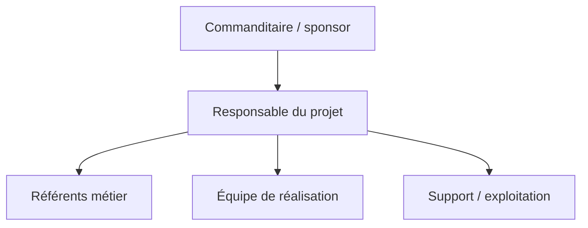

# Structure du projet — [Nom du projet]

## 1. Identification

| Information | À compléter |
| --- | --- |
| Nom du projet | [Nom du projet] |
| Client / commanditaire | [Nom, organisation] |
| Analyste(s) | [Noms] |
| Date | [AAAA-MM-JJ] |
| Version | [Version] |
| Document d’analyse lié | [Lien vers l’analyse des besoins] |

## 1. Objectif et périmètre

**Objectif de ce document :** [Décrire l’organisation du projet et la manière dont les responsabilités, décisions et échanges sont répartis.]

**Périmètre couvert :** [Équipes, partenaires, phases et activités concernés.]

**Documents liés :** [Liens Obsidian vers le cahier des charges, l’analyse des besoins, l’architecture, le backlog ou d’autres références.]

## 2. Principes d’organisation

- **Principe :** [Ex. : responsabilité clairement attribuée]
- **Principe :** [Ex. : décisions prises au niveau le plus proche du travail concerné]
- **Contraintes organisationnelles :** [Disponibilités, règles internes, dépendances ou limites connues]

## 3. Organisation du projet

### Vue d’ensemble

[Décrire brièvement les équipes et les liens entre le commanditaire, la coordination, les métiers, la réalisation et l’exploitation.]

### Organigramme



[Adapter ou remplacer le schéma selon l’organisation réelle du projet.]

### Équipes et groupes de travail

| Équipe / groupe | Mission | Membres ou profils | Responsable | Période / disponibilité |
| --- | --- | --- | --- | --- |
| [Équipe] | [Mission et résultats attendus] | [Profils ou noms] | [Nom / rôle] | [Période ou charge] |

## 4. Rôles et responsabilités

| Rôle | Personne / équipe | Responsabilités principales | Autorité / décisions possibles | Remplaçant ou relais |
| --- | --- | --- | --- | --- |
| Commanditaire | [Nom / organisation] | [Vision, financement, arbitrages majeurs] | [Décisions réservées] | [Nom / rôle] |
| Responsable du projet | [Nom] | [Coordination, suivi du périmètre, délais et risques] | [Décisions déléguées] | [Nom / rôle] |
| Référent métier | [Nom / équipe] | [Besoins, règles métier, validation fonctionnelle] | [Acceptation métier] | [Nom / rôle] |
| Équipe de réalisation | [Noms / équipe] | [Conception, réalisation et vérification] | [Choix dans le cadre convenu] | [Nom / rôle] |
| Support / exploitation | [Nom / équipe] | [Mise en service, assistance et maintien en condition] | [Décisions opérationnelles] | [Nom / rôle] |

### Matrice des responsabilités

Utiliser R = réalise, A = responsable final et redevable, C = consulté, I = informé. Attribuer un seul A par activité lorsque c’est possible.

| Activité / livrable | Commanditaire | Responsable projet | Référent métier | Équipe de réalisation | Support / exploitation |
| --- | --- | --- | --- | --- | --- |
| [Définir et valider le périmètre] | [A/C/I] | [R/A/C/I] | [R/A/C/I] | [R/A/C/I] | [R/A/C/I] |
| [Valider les exigences] | [A/C/I] | [R/A/C/I] | [R/A/C/I] | [R/A/C/I] | [R/A/C/I] |
| [Réaliser et vérifier la solution] | [A/C/I] | [R/A/C/I] | [R/A/C/I] | [R/A/C/I] | [R/A/C/I] |
| [Accepter et mettre en service] | [A/C/I] | [R/A/C/I] | [R/A/C/I] | [R/A/C/I] | [R/A/C/I] |

## 5. Gouvernance et décisions

### Instances de gouvernance

| Instance | Participants | Responsabilité | Fréquence / déclencheur | Sorties attendues |
| --- | --- | --- | --- | --- |
| [Comité de pilotage / réunion d’équipe / revue technique] | [Rôles] | [Suivi, arbitrage ou validation] | [Fréquence] | [Décisions, actions, compte rendu] |

### Processus de décision

1. [La question ou le besoin de décision est documenté par son responsable.]
2. [Les impacts, options et personnes à consulter sont identifiés.]
3. [La personne ou l’instance habilitée prend et consigne la décision.]
4. [La décision est communiquée aux personnes concernées et les documents liés sont mis à jour.]

| Domaine de décision | Décideur / instance | Personnes consultées | Délai ou règle d’escalade |
| --- | --- | --- | --- |
| [Périmètre, budget, priorité, architecture, mise en production…] | [Rôle / instance] | [Rôles] | [Règle] |

### Gestion des désaccords et escalade

[Indiquer comment un désaccord est documenté, qui facilite sa résolution, le délai de décision et le niveau d’escalade si aucun accord n’est trouvé.]

## 6. Communication et coordination

| Échange / réunion | Participants | Objectif | Fréquence | Canal / compte rendu |
| --- | --- | --- | --- | --- |
| [Point de suivi] | [Rôles] | [Objectif] | [Fréquence] | [Outil / emplacement] |

### Règles de communication

- **Canal de référence :** [Outil ou emplacement pour les communications officielles]
- **Documentation des décisions :** [Emplacement et responsable de mise à jour]
- **Diffusion des changements :** [Personnes à informer et délai]
- **Disponibilité attendue :** [Plages de travail ou délai de réponse, si nécessaire]

## 7. Processus de travail

| Processus | Déclencheur | Responsable | Étapes principales | Résultat / preuve |
| --- | --- | --- | --- | --- |
| [Gestion d’une demande ou d’un changement] | [Événement] | [Rôle] | [Étapes] | [Décision, ticket, document…] |
| [Validation d’un livrable] | [Livrable prêt] | [Rôle] | [Revue, retours, approbation] | [Statut et preuve de validation] |
| [Traitement d’un blocage] | [Blocage identifié] | [Rôle] | [Signalement, analyse, escalade] | [Résolution ou décision] |

### Outils et espaces de travail

| Outil / espace | Usage | Responsable | Règles d’accès ou de classement |
| --- | --- | --- | --- |
| [Outil de suivi, dépôt documentaire, communication…] | [Usage] | [Rôle] | [Règles] |

## 8. Arborescence du projet

Présenter l’organisation des dossiers et fichiers utilisés pour le projet. Adapter l’exemple aux conventions du projet et supprimer les éléments inutilisés. Si le code source est hébergé séparément, indiquer son dépôt et documenter son arborescence dans la documentation technique.

```text
[Nom du projet]/
├── 00 - Project Overview.md
├── 01 - Requirements.md
├── 02 - Architecture.md
├── 03 - Roadmap.md
├── 04 - Decisions.md
├── 05 - Meetings.md
├── [Autres documents de référence].md
├── [Dossier de travail]/
│   └── [Sous-dossier ou fichier]
└── [Dossier de livrables ou pièces jointes]/
	└── [Fichier]
```

| Dossier / fichier | Contenu et finalité | Responsable | Règles de classement, accès ou conservation |
| --- | --- | --- | --- |
| [Chemin relatif] | [Documents ou fichiers à y conserver] | [Rôle] | [Convention de nommage, droits, archivage…] |

- **Emplacement principal :** [Chemin du dossier ou lien vers le dépôt]
- **Dépôt du code source, si distinct :** [Lien / emplacement]
- **Convention de nommage :** [Règle appliquée aux dossiers et fichiers]
- **Éléments exclus ou à ne pas versionner :** [Secrets, fichiers temporaires, données personnelles…]

## 9. Continuité et évolution de l’organisation

- **Absence ou indisponibilité d’un rôle clé :** [Relais et transfert des responsabilités]
- **Arrivée ou départ d’un membre :** [Accueil, accès, transfert de connaissances]
- **Évolution des équipes ou responsabilités :** [Processus de mise à jour et personnes à informer]
- **Compétences ou ressources manquantes :** [Besoin, impact et action prévue]

## 10. Points ouverts et risques organisationnels

| Point / risque | Impact | Responsable | Action ou décision attendue | Échéance / statut |
| --- | --- | --- | --- | --- |
| [À clarifier] | [Impact sur le projet] | [Nom / rôle] | [Action] | [Date / ouvert] |

## 11. Vérification et validation

- [ ] Les rôles et responsabilités sont attribués et compris.
- [ ] Les activités importantes ont un responsable et une autorité de décision identifiés.
- [ ] Les instances, fréquences et sorties de gouvernance sont définies.
- [ ] Les canaux de communication et espaces documentaires sont connus.
- [ ] Les relais et modalités d’escalade sont définis pour les situations pertinentes.

| Validateur | Rôle | Validation / remarques | Date |
| --- | --- | --- | --- |
| [Nom] | [Commanditaire / responsable projet / autre] | [À valider / validé / remarques] | [AAAA-MM-JJ] |

## 12. Historique des versions

| Version | Date | Auteur | Modifications |
| --- | --- | --- | --- |
| 0.1 | [AAAA-MM-JJ] | [Nom] | Création du document |
